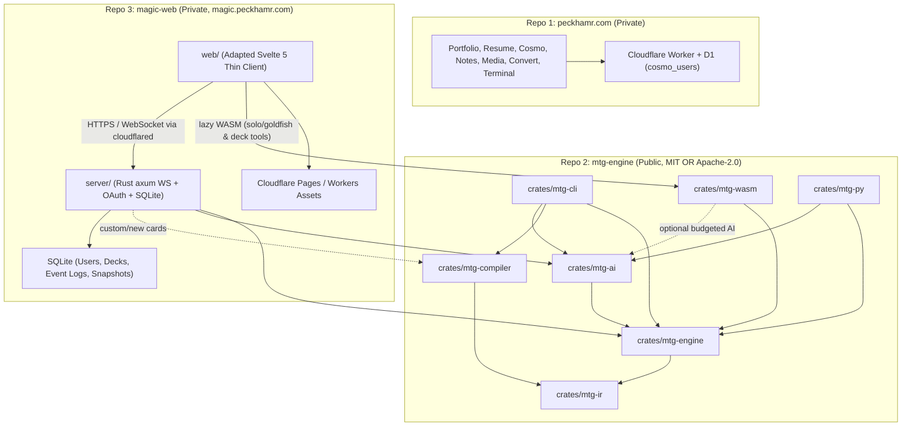

# 01 — High-Level Vision, Locked Decisions & 3-Repo Topology

## 1. Why Transition from TypeScript to Rust?

The TypeScript engine in `peckhamr.com/src/lib/magic/` already succeeded at the hardest conceptual milestone in MTG engineering: proving a strict **Card IR Wall** (`oracleTextRead = 0`, `cardNameComparison = 0`, `directZoneMutation = 0`), a 6-kind choice protocol, pausable resolution, and 100% support across 41 precon decks (72.5% of all 35,062 Scryfall game cards).

Moving to Rust is **not** a line-by-line port—it is a clean-slate v2 architecture driven by three long-term goals that outgrow the TypeScript monolith:

1. **Exceptionally strong MTG AI on homelab hardware:** Moving beyond 1-ply heuristics (`ai.ts`) to multi-threaded Information-Set MCTS (`rayon`) and eventually self-play neural value/policy networks requires compact, microsecond-cloneable game state (~8–20 KB flat arenas instead of 669 KB JS object graphs), zero-GC search loops, low-branching sequential decision points, and native `PyO3`/ONNX integration.
2. **Shipping a standalone reusable engine:** Packaging the rules engine cleanly for external Rust (`crates.io`), JS/TS (`npm` via WASM), and Python (`PyPI` via `PyO3`) consumers without dragging along personal portfolio code, OAuth handlers, or Scryfall/WotC data.
3. **Fixing structural debts cleanly:** Enforcing mutation-tracked O(1) layer invalidation via Rust ownership (eliminating the ~50% CPU fingerprint-validation tax observed in TS), implementing true `CR 613.8` dependencies, unifying `CR 614–616` replacements, and routing the stack through the `CR 400.7` zone funnel.

---

## 2. Three-Repository Split & Ownership Boundaries

The current monolith (`/home/ryan/statikana/peckhamr.com`) splits into **three repositories** with strict dependency direction (`magic-web` depends on `mtg-engine` like any external consumer; `peckhamr.com` has zero Magic code after cutover):

### Repository Policies

| Repository | Visibility & License | Owns | Must Never Contain |
|---|---|---|---|
| **`peckhamr.com`** | Private | Personal site, resume, Cosmo/Notes/Media/Convert/Terminal apps, Cloudflare Worker for non-Magic subdomains. | Any Magic engine/UI/backend code (after Phase 4 cutover). |
| **`mtg-engine`** | Public, dual **`MIT OR Apache-2.0`** | Reusable IR, deterministic rules engine, AI, Oracle compiler, CLI, WASM & Python bindings. | `peckhamr.com` OAuth/ops/UI, SQLite user tables, or **WotC/Scryfall bulk card text, artwork, or flavor text**. |
| **`magic-web`** | Private (can open later) | `magic.peckhamr.com` Svelte 5 UI, Rust `axum` multiplayer server, OAuth, Scryfall image proxy/deck import, SQLite migrations, homelab systemd/backup/`cloudflared` ops. | Duplicate MTG rules logic (all rules/AI live in `mtg-engine` / `mtg-ai` / `mtg-wasm`). |

> **Legal / IP Hygiene Rule:** Keep Wizards of the Coast / Scryfall card data completely outside the `mtg-engine` git repo and published crates. Users and `magic-web` build `cards.bin` locally from Scryfall bulk data via `mtg-cli build-db`. Unit tests in `mtg-engine` use synthetic/renamed cards (upholding rename invariance from `ENGINE_INVARIANTS.md` §1.3).

---

## 3. Cargo Workspace Crate Responsibilities

| Crate | Pure / No-IO? | Compiles to WASM? | Primary Responsibility |
|---|---|---|---|
| `mtg-ir` | Yes | Yes (`--no-default-features`) | Versioned IR v2 types, bitmasks, pre-parsed `ManaCost`, `CardDatabase`, `cards.bin` (`postcard` + optional `zstd`). Zero regexes. |
| `mtg-engine` | Yes | Yes | Deterministic rules core, arena `GameState`, `CR 613` layers, `CR 614–616` replacements, `CR 400.7` zones, sequential `Action` / `MacroAction` / `MatchSession` façade, `determinize`, `Observation`, `ClientViewModel`. |
| `mtg-ai` | Yes (`rayon` gated) | Yes (single-threaded budget) | Board/tempo heuristics, parallel ISMCTS, pluggable `Evaluator`/`Policy` traits for future ONNX/Candle/PyTorch models. |
| `mtg-compiler` | Pure parser (file IO optional) | Native/server only (excluded from browser WASM) | Tokenizer + recursive-descent Oracle text parser targeting `mtg-ir` v2, plus hash-gated override loader. |
| `mtg-cli` | Native binary | No | `build-db`, `inspect-db`, `coverage`, `diff-test` (TS↔Rust differential runner), `tournament` (AI benchmarks). |
| `mtg-wasm` | Stateful handle | Yes (`wasm-bindgen`) | Thin stateful `WasmMatch` wrapper over `MatchSession` for npm and `magic-web` offline solitaire/deck tools. |
| `mtg-py` | Native extension | No (`PyO3` / `maturin`) | Python `PyMatch` and batched `VecEnv` stepping with dense NumPy/array observations for ML/RL training. |
| *`mtg-ffi` (deferred)* | *Post-v1* | *No* | *C/C++ `cbindgen` wrapper over the same message-oriented `MatchSession` façade once v1 API stabilizes.* |

---

## 4. Zero-Downtime Phased Sequencing & Exit Gates

The TS engine in `peckhamr.com` stays live and playable throughout the migration. Never maintain two diverging copies of the TS engine.

| Phase | Core Deliverables | Hard Exit Gate |
|---|---|---|
| **Phase 0** | Workspace scaffold, `mtg-ir` v2 schema, `cards.bin` codec, temporary `scripts/export-ir-v2.ts` & `scripts/record-ts-replay.ts` in `peckhamr.com`. | `mtg-cli build-db` deserializes all 41 precons (2,188 cards) and 35,062 Scryfall cards with `#[serde(deny_unknown_fields)]` and zero dropped fields; `cards.bin` loads in <50 ms; `Mulberry32` matches TS shuffles bit-for-bit. |
| **Phase 1** | Arena `GameState`, `CR 400.7` zone funnel (incl. stack), mutation-tracked `CR 613` layers (`613.8` deps, `Option<Pt>`), unified `CR 614–616` replacements, turn/priority/casting/SBA loop, `GameConfig` + Commander module. | 1v1 and 4-player core rules suite passes; state `Clone` <20 µs; >10,000 steps/sec single-threaded on mid-game board. |
| **Phase 2** | Full `EffectOp`, `TriggerDef`, `StaticDef`, `CostDef`, multi-face/frame mechanics, and 214+ keywords implemented; TS↔Rust differential fuzzer running. | **41/41 precon decks** pass multi-turn deterministic differential replay tests against TS with zero crashes and zero unexplained divergences. |
| **Phase 3** | Parallel ISMCTS (`mtg-ai`), stateful `mtg-wasm` npm package, `mtg-py` batched `VecEnv`. | ISMCTS beats 1-ply heuristic baseline decisively in `mtg-cli tournament`; gzipped `.wasm` <1.2 MB with <1 ms UI queries; `mtg-py` >20k steps/sec. |
| **Phase 4** | Create `magic-web` repo (`axum` WS actors + SQLite event logs + migrated users/decks + adapted Svelte 5 thin client + lazy WASM), soak on `beta.magic.peckhamr.com`, cut over `magic.peckhamr.com`, remove Magic from `peckhamr.com`. | Live multiplayer, OAuth, reconnect/restart replay recovery, ISMCTS bots, and offline WASM solitaire verified in production; `peckhamr.com` deploys cleanly with zero Magic files. |
| **Phase 5** | Native Rust `mtg-compiler` (lexer + recursive-descent parser + overrides) verified against TS compiler across all 35,062 Scryfall cards; delete temporary TS exporter; publish crates/npm/PyPI. | `mtg-compiler` matches or exceeds TS coverage (`>= 25,417/35,062` cards, `41/41` precons @ 100%, `0` errors) with zero TS dependency. |
