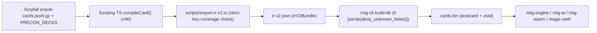

# 02 — Card IR v2 & Binary Card Database (`mtg-ir`)

## 1. Preserving the IR Wall

All invariants from `peckhamr.com/src/lib/magic/docs/ENGINE_INVARIANTS.md` §1 carry forward unchanged—and are now enforced by Rust's crate graph rather than regex ratchets:

1. **Zero Oracle-text reads in `mtg-engine` / `mtg-ai` / `mtg-wasm`:** `CardDef` does not even store `oracle_text` on playable faces (only display `text` on abilities/unsupported fallbacks). The rules engine physically cannot parse English text.
2. **Zero card-name dispatch:** `CardDef.name` exists strictly for UI display, logs, and rules that semantically compare names (`CR 704.5j` Legend Rule, `CR 201.2` named filters, `Partner with`). Rename invariance (replacing a card's name with a synthetic name produces identical gameplay) remains mandatory for all unit tests.
3. **Pure, context-free compilation:** `CardDef` never depends on `GameState`, commander color identity, or player state. Dynamic values remain symbolic (`Amount`, `ManaProduction`, `PlayerRef`).
4. **Honest support surface:** Any unparsed clause becomes an explicit `AbilityDef::Unsupported` node and sets `CardDef.fully_supported = false`. Nothing is silently dropped.

---

## 2. Why IR v2 Instead of Mirroring TS `ir.ts` 1:1?

`peckhamr.com/src/lib/magic/ir.ts` grew cleanly through 46 compiler versions and 13 feature waves, accumulating five structural inefficiencies that should **not** be baked into a public Rust crate:

| TS `ir.ts` v1 Pattern | Problem in Rust / High-Speed AI | `mtg-ir` v2 Solution |
|---|---|---|
| `EffectParams` (644-line flat struct of ~150 optional fields shared across 127 verbs) | Huge enum/struct footprint, invalid verb+param states representable, weak exhaustiveness. | **`EffectOp` tagged enum:** each verb carries *only* its own typed payload struct. Shared step fields (`actor`, `optional`, `gate`, `bind_as`, `reflexive_trigger`) live on `EffectStep`; shared object-subset options (`choice_count`, `up_to`, `at_random`, `filter`, `chooser`) live in a compact `SelectionMod`. |
| `ObjectFilter` (298-line flat struct of ~95 optional fields, string arrays for types/subtypes/colors) | Every filter check allocates or scans strings and checks dozens of `Option`s. | **Fast-path bitmasks + `extra: Vec<ObjectPredicate>`:** `ZoneMask(u8)`, `CardTypeMask(u16)`, `SupertypeMask(u8)`, `ColorMask(u8)`, `FilterFlags(u64)`, interned `SmallVec<[SubtypeId; 2]>`. ~95% of filters execute in nanoseconds with `extra.is_empty()`. |
| `ReplacementDef.with = { k: 'modify', ...55 optional fields }` | Mixes zone-change, ETB copy, ETB choices, damage scaling, draw scaling, and life gain in one bag. | **`ReplacementWith` tagged enum:** `Skip`, `Execute`, `ZoneChange(Box<ZoneChangeMod>)`, `DamageScale`, `DamageToMinusCounters`, `DamageToSelfAsCounters`, `LifeGainScale`, `DrawScale`, `StealOpponentExtraDraws`, `AbundanceDrawChoice`, `EmptyLibraryGraveyardReanimate`, `ProliferateMultiplier`, `RegenerateSelfOnDestroy`. |
| `EventFilter` (230-line flat struct of ~70 optional fields across 82 event kinds) | Massive sparse structs on every trigger. | **`EventFilter` (common fields) + `Option<EventDetail>` enum** grouped by event domain (`ZoneChange`, `Cast`, `Combat`, `Damage`, `Phase`, `Counter`, `BecomesTarget`, `Attach`, `Mana`, `AbilityActivated`, `Discard`, `Draw`, `Transform`, `Tapped`, `DieOrCoin`, `State`, `Misc`). |
| `RuleModKind` + `params?: Record<string, unknown>` | Untyped escape hatch requiring runtime JSON/dynamic checks. | **`RuleMod` strongly-typed enum:** all 16 parameterized rules carry exact typed fields (verified empirically against all 35,062 Scryfall cards). |
| Wave-named wrappers (`p17bMetric`, `p17bCondition`, `p20bCondition`, `p20bCostPaidCount`) | Leaks historical TS track names into public API. | **Flattened domain variants** directly on `Amount` and `Condition`. |
| Raw strings everywhere (`"{2}{U}{U}"`, `"Elf"`, `"+1/+1"`, `"flying"`, `power?: number` + `ptDefinedByAbility`) | Runtime re-parsing (14% of TS CPU in face/typeline parsing), string comparisons in hot loops. | **Pre-parsed `ManaCost`** (`generic`, `x_count`, `SmallVec<[ManaPip; 4]>`), **interned IDs** (`SubtypeId(u16)`, `CounterId(u16)`, `KeywordId(u16)`), and explicit **`Option<PrintedPt>`** (`Fixed { power, toughness } | Cda { power, toughness }`). |

A reference implementation of this schema is already sketched in [`crates/mtg-ir/src/`](../crates/mtg-ir/src/).

---

## 3. `CardDatabase` & `cards.bin` Binary Format

### Runtime Layout (`Arc<CardDatabase>`)

- `CardDatabase` is constructed once at process/WASM startup and shared immutably via `Arc<CardDatabase>` across all live games and all parallel ISMCTS rollout threads.
- **Intern tables (`InternTables`):**
  - `subtypes: Vec<String>` → indexed by `SubtypeId(u16)` (canonical title-case, e.g. `"Elf"`, `"Forest"`).
  - `counters: Vec<String>` → indexed by `CounterId(u16)` (canonical lower-case, e.g. `"+1/+1"`, `"-1/-1"`, `"loyalty"`, `"stun"`).
  - `keywords: Vec<String>` → indexed by `KeywordId(u16)` (canonical lower-case, e.g. `"flying"`, `"ward"`, `"equip"`).
- **Dense card array:** `cards: Vec<CardDef>` indexed by `CardDefId(u32)` (`O(1)` slice lookup in hot paths), with startup-built `HashMap` indexes `oracle_id -> CardDefId` and `name -> CardDefId` for deck loading and name-filter lookup.
- **Optional deck list table:** `decks: Vec<DeckDef>` storing precon decklists as `CardDefId`/`oracle_id` + counts (never duplicating card definitions).

### Binary Wire Format (`cards.bin`)

```text
Offset  Size   Field
0       4      Magic bytes: b"MTGC"
4       4      IR_V2_VERSION (u32 little-endian, currently 2)
8       1      Compression flag: 0 = raw postcard (WASM-safe), 1 = zstd-compressed postcard (native/CLI/server)
9       N      Payload: postcard-encoded IrV2Bundle
```

**Why dual compression modes?**
- **Native / Homelab / CLI (`zstd` feature enabled):** All 35,062 compiled cards compress to a few megabytes and decompress in ~15–40 ms.
- **Browser WASM (`--no-default-features`):** Zero C dependencies (`zstd-sys` excluded). Browser fetches either a gzip/brotli-HTTP-compressed raw-`postcard` deck pack (~50–150 KB for a 4-player match's ≤400 distinct cards, decoded automatically by browser `Content-Encoding`) or the full raw DB, with zero C toolchain friction on `wasm32-unknown-unknown`.

---

## 4. Temporary TS → IR v2 Bootstrap Bridge (Phase 0 → Phase 4)

To avoid rewriting 60,000 LOC of regex compiler before building the engine, `peckhamr.com` hosts a temporary bridge script (`scripts/export-ir-v2.ts`) until Phase 5 (`mtg-compiler`) replaces it:



### Mandatory Bridge Contract
1. **Zero silent drops in `export-ir-v2.ts`:** Every object translated from `ir.ts` (`EffectParams`, `ObjectFilter`, `EventFilter`, `ReplacementDef.with`, `StaticDef`, `Amount`, `Condition`, `CostDef`, `KeywordDef`, `ModalDef`) must track consumed keys and **throw immediately** if any defined key on any of the 35,062 Scryfall cards is unhandled.
2. **Strict deserialization in Rust:** Every struct in `mtg-ir` carries `#[serde(deny_unknown_fields)]`, so `mtg-cli build-db` rejects any schema drift on the spot.
3. **Deterministic interning:** `export-ir-v2.ts` sorts `tables.subtypes`, `tables.counters`, and `tables.keywords` lexicographically (or assigns canonical IDs deterministically) so rebuilding `cards.bin` from the same corpus is byte-reproducible.
4. **Card metadata sidecar (for UI only):** `mtg-ir` stores rules-relevant characteristics only. UI-only display fields (`imageUrl`, `artCropUrl`, `rarity`, printed `oracleText`, `flavorText`) stay out of `mtg-engine` and live in `magic-web`'s card-metadata cache/SQLite (`MagicCardImages` / Scryfall cache).
