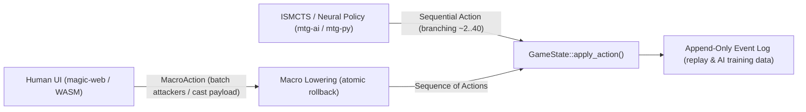

# 04 — Unified Action Protocol, Sequential Decisions & AI Design (`mtg-engine` + `mtg-ai`)

## 1. Why Decomposing Actions Is Essential for Strong MTG AI

In the TypeScript engine (`types.ts` lines 3542–3705), `GameActionPayload` uses monolithic macro-actions:
- `declare_attackers` takes an entire `assignments[]` array at once. In 4-player Commander with 10 creatures, there are **$4^{10} = 1,048,576$** legal assignments.
- `declare_blockers` takes all blocker assignments simultaneously (factorial branching).
- `cast_spell` bundles `optionId`, `modes`, `xValue`, `targets`, `targetDivisions`, `optionalCostCounts`, `costAidIds`, `giftRecipientId`, and `costPayment` in one payload.

No tree-search algorithm (MCTS) or policy network can enumerate millions of macro-actions at a single node. **`mtg-engine` solves this with a two-layer Action design:**

1. **Canonical Low-Branching Sequential `Action` (native engine + AI layer):** Every compound decision (casting a spell, declaring attackers, declaring blockers, paying variable costs, answering a prompt) decomposes into a short sequence of atomic decision states where `legal_actions(&self, player)` typically returns **2 to 40** moves.
2. **UI Convenience `MacroAction` (server/WASM adapter layer):** Humans in `magic-web` still click a single "Confirm Attackers" or "Cast Spell" button; `MatchSession::apply_macro_action()` deterministically lowers a `MacroAction` into the exact sequence of canonical `Action`s (and rolls back cleanly if any sub-step is illegal).



---

## 2. Decision State Machine (`DecisionState`)

At every point in a game, `GameState::current_decision()` reports **who must act next** (`PlayerId`) and **which exact decision state** the engine is waiting on:

| `DecisionState` | Branching Factor | Canonical `Action` Variants |
|---|---|---|
| `Mulligan` | 2 (or hand size) | `KeepHand`, `TakeMulligan`, `BottomCard(ObjectId)` (sequential London bottoming) |
| `Priority` | ~1–25 | `PassPriority`, `PlayLand { object, face }`, `BeginCast { object, option_id }`, `BeginActivate { object, ability_id }`, `SpecialAction(SpecialActionKind)`, `TapMana { object, ability_id, choice }`, `Concede` |
| `CastingSequence` *(CR 601.2b–h)* | ~2–20 per sub-step | Sub-states only entered when needed: `ChooseMode(u16)` → `ChooseX(u16)` → `ChooseOptionalCost` → `ChooseTarget(TargetRef)` → `AllocateDivision` → `ChooseManaPayment` (auto-tap shortcut or manual tap) → `PayNonManaCost` |
| `DeclareAttackersStep` | `1 + (attackable × defenders)` (~5–30) | `AssignAttacker { attacker, target: AttackTarget }`, `RemoveAttacker(ObjectId)`, `ConfirmAttackers` (also handles `Banding` groups if present) |
| `DeclareBlockersStep` | `1 + (blockers × attackers)` (~5–30) | `AssignBlocker { blocker, attacker }`, `ConfirmBlockers` |
| `AssignCombatDamageOrder` | ~2–6 | `OrderObject(ObjectId)` / `AllocateDamage { target, amount }` |
| `Prompt(ChoiceRequest)` | ~2–30 | Answers one of the **6 canonical choice kinds** (preserving `ENGINE_INVARIANTS.md` §6): `YesNo(bool)`, `PickObject(ObjectId)` + `DonePicking`, `PickMode(u16)`, `PickNumber(i32)`, `OrderNext(ObjectId)`, `PickReplacement(u16)` (+ optional `GuidedOps` when `allow_guided_fallback` is enabled) |

### Mapping Every Legacy TS `GameActionPayload` Variant

| TS `GameActionPayload` (`types.ts`) | Rust Target |
|---|---|
| `mulligan_keep` / `mulligan_take` / `london_bottom` | `DecisionState::Mulligan` (`Action` + `MacroAction::LondonBottom`) |
| `pass_priority` / `end_turn` | `Action::PassPriority` (`end_turn` = server/UI auto-pass macro until end step) |
| `play_land` / `tap_mana` / `suspend_card` / `turn_face_up` / `unlock_room_door` / `hand_special_action` / `companion_to_hand` | `DecisionState::Priority` actions |
| `cast_spell` / `cast_preparation_copy` / `activate_ability` | `Action::BeginCast` / `BeginActivate` → `CastingSequence` (plus `MacroAction::CastSpell` for single-click UI) |
| `declare_attackers` / `declare_blockers` | `DeclareAttackersStep` / `DeclareBlockersStep` (plus `MacroAction` batch submission for UI) |
| `choice` / `cost_choice` / `discard_cards` / `discard_hand_size` / `commander_zone_*` / `search_library_pick` / `scry_*` / `legend_rule_*` | **All unified** under `DecisionState::Prompt(ChoiceRequest)` (eliminating TS's legacy alias variants!) |
| `guided_resolve` / `guided_resolution_finish` / `resolve_manually` | Optional `GuidedFallback` hook (enabled only when `GameConfig.allow_guided_fallback == true`) |
| `toggle_full_control` / `toggle_stop_phase` | **UI/server preference state** (lives in `magic-web`, never inside `GameState`!) |
| `concede` | `Action::Concede` |

---

## 3. Hidden Information & Determinization (`determinize`)

Magic is an imperfect-information game: opponents' hands, libraries, and face-down cards are hidden (`CR 400.2`). To run Information-Set MCTS (ISMCTS), `mtg-engine` provides first-class **consistent determinization**:

```rust
pub struct DeterminizeConfig {
    /// Known decklists (e.g., open-decklist tournament or precon match) vs. archetype priors.
    pub known_decklists: Option<Vec<Vec<CardDefId>>>,
}

impl GameState {
    /// Returns a cloned GameState where all hidden information invisible to `viewer`
    /// is resampled consistently with every public fact and viewer-known reveal.
    pub fn determinize(
        &self,
        viewer: PlayerId,
        cfg: &DeterminizeConfig,
        rng: &mut impl RngCore,
    ) -> GameState;
}
```

### Consistency Rules for `determinize(viewer, rng)`
1. **Preserve all public & viewer-known facts:** Battlefield (except opponents' unknown face-down cards), graveyards, face-up exile, stack, command zones, `viewer`'s hand, any card currently revealed to `viewer` (via *Thoughtseize*, `topOfLibraryVisibility`, *Bane Alley Broker*, scried top/bottom cards remembered for `viewer`).
2. **Partition unknown cards per opponent:** Pool that opponent's unrevealed hand cards + unknown library cards + unknown face-down exile cards, shuffle with `rng`, and deal back exact zone counts (keeping any viewer-known top/bottom library cards pinned in place).
3. **Never leak ground truth:** `determinize` must produce the exact same distribution whether called on the authoritative server state or on a viewer-redacted state!

---

## 4. `Observation` API (Ready for Future Neural Value/Policy Networks)

Separating `Observation` (numeric/structured ML input) from `ClientViewModel` (UI rendering JSON) ensures AI training never parses display strings:

- **Global features:** turn number, active player (relative to viewer), priority player, phase one-hot, stack depth, monarch/initiative/day-night flags.
- **Per-player features (rotated into viewer-first order `[self, opp_1, opp_2, opp_3]`):** life total, commander damage matrix, poison/energy/experience/rad counters, mana pool (available + untapped land potential by color), hand count, library count, graveyard/exile counts, spells cast this turn, lost flag.
- **Entity list (variable-length set / attention-ready):** Every visible object (battlefield permanents, stack items, viewer's hand, graveyards, visible exile, command zones) encoded with `(entity_id, card_def_id, zone, owner_rel, controller_rel, evaluated_pt, types_mask, keywords_mask, tapped, summoning_sick, counters_summary, attached_to_idx)`.
- **Action mask / action features:** Aligned 1:1 with `legal_actions(viewer)`, encoding action kind + referenced `entity_id`s so a pointer/attention policy network (AlphaStar / Transformer style) can score any legal action directly without fixed action-table overflow.

---

## 5. `mtg-ai` Roadmap: Heuristic ISMCTS → Neural-Guided ISMCTS

### Stage A — Fast Tactical Heuristic Evaluator + Parallel ISMCTS (Phase 3)
Built purely in Rust inside `crates/mtg-ai` (using `rayon` on native homelab, single-threaded budget on WASM):

1. **Trait abstraction from Day 1:**
   ```rust
   pub trait StateEvaluator: Send + Sync {
       /// Returns per-player win probability vector summing to 1.0 (handles 2..N players cleanly!).
       fn evaluate(&self, state: &GameState) -> SmallVec<[f32; 4]>;
       /// Optional prior probabilities aligned with `legal_actions` (PUCT guidance).
       fn policy_priors(&self, state: &GameState, actions: &[Action]) -> Vec<f32>;
   }
   ```
   Using a **per-player win-probability vector `[p_0, p_1, ..., p_{n-1}]`** (MaxN / multiplayer UCT) handles 1v1 (`[p, 1-p]`) and 4-player Commander (`[p0, p1, p2, p3]`) uniformly—crucial for realistic Commander threat assessment!
2. **Mana-action pruning & macro-shortcuts inside search:**
   - During search, do **not** branch on arbitrary land-tapping orders unless manual mana matters; expose auto-tap-backed cast/activate moves so search depth goes into *tactical sequencing, combat math, hold-up interaction, and target selection*.
   - For combat with large boards, seed ISMCTS priors with a fast tactical combat heuristic (alpha-beta / lethal-check + profitable-block estimator) so the tree immediately explores realistic attacks/blocks instead of random subsets.
3. **Root-parallel + tree-parallel ISMCTS (`rayon`):**
   - Run `K` independent determinizations across CPU cores (e.g., 16–64 determinizations × 50–200 simulations each within a 200 ms–2 s homelab budget), aggregating root visit counts across determinizations.
4. **Bot pacing & strength levels (`magic-web`):**
   - Expose configurable `AiDifficulty`: `FastHeuristic` (1-ply, <5 ms), `Tactical` (100 ms ISMCTS), `Strong` (500 ms–2 s multi-core ISMCTS), and later `NeuralIsmcts` (ONNX/Candle GPU/CPU inference).

### Stage B — Self-Play & Imitation Neural Training (Post-Phase 5)
- Harvest `magic-web`'s append-only SQLite human/bot replay logs for supervised warm-start (behavior cloning) + run `mtg-py` vectorized self-play (`VecEnv`) in PyTorch.
- Export quantized policy/value networks to ONNX (`ort`) or `candle` and plug directly into `impl StateEvaluator for NeuralEvaluator`—requiring **zero changes** to `mtg-engine` or `mtg-ai`'s ISMCTS search core.
