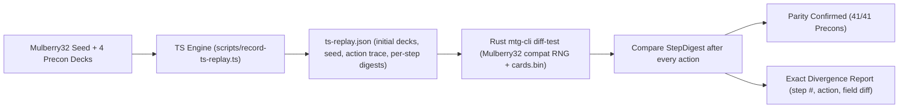

# 07 — Differential Testing Protocol & Native Rust Compiler Plan

## 1. Using the Live TS Engine as an Executable CR Oracle (Phases 0–2)

The biggest risk when rewriting a 214k-LOC MTG engine is silent Comprehensive Rules drift across obscure card interactions. Your existing TS engine (41/41 precons @ 100%, 1,920 tests) eliminates guesswork by acting as an **automated differential oracle**.



### 1.1 Deterministic Replay Trace Schema (`ts-replay.json`)

`scripts/record-ts-replay.ts` in `peckhamr.com` drives deterministic games using `PRECON_DECKS` (capturing every action submitted by `runAutomatedPriorityAndBots` or scripted test scenarios) and emits:

```json
{
  "formatVersion": 1,
  "compilerVersion": 46,
  "seed": 123456789,
  "rules": {
    "startingLife": 40,
    "commander": true,
    "freeFirstMulligan": true
  },
  "seats": [
    { "seat": 0, "deckId": "elven_empire", "commanders": ["oracle_id_1"], "libraryOrderInitial": ["oracle_id_..."] }
  ],
  "steps": [
    {
      "stepIndex": 0,
      "actorSeat": 0,
      "action": { "type": "mulligan_keep" },
      "digestAfter": {
        "turnNumber": 1,
        "activeSeat": 0,
        "prioritySeat": 0,
        "phase": "main1",
        "stackDepth": 0,
        "pendingPromptKind": null,
        "players": [
          {
            "seat": 0,
            "life": 40,
            "lost": false,
            "poison": 0,
            "energy": 0,
            "manaPool": [0, 0, 0, 0, 0, 0],
            "zoneCounts": { "library": 92, "hand": 7, "battlefield": 0, "graveyard": 0, "exile": 0, "command": 1 },
            "handOracleIds": ["..."],
            "battlefield": [
              {
                "oracleId": "...",
                "tapped": false,
                "pt": [2, 2],
                "types": ["Creature"],
                "keywords": ["deathtouch"],
                "counters": [["+1/+1", 1]],
                "damageMarked": 0,
                "attachedToOracleId": null
              }
            ]
          }
        ]
      }
    }
  ]
}
```

### 1.2 Why `Mulberry32` Matching Matters
- Because Rust implements the exact 5-line `Mulberry32` and Fisher-Yates shuffle from [`runtime/random.ts`](file:///home/ryan/statikana/peckhamr.com/src/lib/magic/runtime/random.ts#L58-L74), **step 0 asserts identical shuffled `libraryOrderInitial` card-for-card** across all 4 seats before a single card is drawn!
- Any PRNG consumption divergence (e.g., an extra shuffle or different random-discard draw order) surfaces immediately at the exact step it happens.

### 1.3 Comparing `StepDigest` & Triaging Intentional CR Improvements
When `mtg-cli diff-test` reports a difference at step `K`:
1. **Unintended bug in Rust:** Fix `mtg-engine`, add a focused synthetic-card unit test (`#[test]`) reproducing the CR rule, and re-run `diff-test`.
2. **Intentional CR improvement in Rust** (the 4 Day-1 CR debt fixes in [`03-ENGINE-DATA-MODEL-AND-INVARIANTS.md`](./03-ENGINE-DATA-MODEL-AND-INVARIANTS.md)):
   - `Option<Pt>` (`None` for non-creatures vs TS `0/0`) and unclamped negative toughness (compare `digest.pt` normalizing TS `0` on non-creatures to `None`, and compare unclamped values when both expose them).
   - `CR 613.8` dependency ordering or `CR 616.1b` control-changing ETB replacement tier differences: record in an explicit allowlist `docs/KNOWN_TS_CR_DIVERGENCES.md` with CR citation and unit test proving Rust is right.
3. **41/41 Precon Parity Bar (Phase 2 Exit Gate):**
   - Generate at least **20 distinct multi-turn 4-player pods** covering all **41 precon decks** (every precon plays multiple pods through Turn 10+, plus targeted scripted traces exercising stack battles, board wipes, clones, Sagas, Battles, DFCs, Rooms, Classes, Cases, and commander tax/zone choices).
   - **100% of pods** must replay cleanly to completion with zero panics, zero `verify-layer-cache` mismatches, and zero unexplained digest divergences.

### 1.4 Porting TS Unit Tests (1,920 Cases)
Do **not** blindly transliterate all 144k LOC of TS test files. Use a three-tier Rust verification pyramid:
1. **Tier 1 — Core CR unit tests (`crates/mtg-engine/tests/`):** Hand-curated, fast, synthetic-card tests covering every CR section (`CR 100–905`), rename invariance, `verify-layer-cache` equivalence, and every one of the 214+ implemented keywords (replacing `keywords-coverage-guard.test.ts`).
2. **Tier 2 — Differential replay suite (`mtg-cli diff-test`):** Covers all 41 precon decks + complex multi-card interactions automatically using TS as the oracle.
3. **Tier 3 — Fuzz / property testing (`proptest` / headless random-agent fuzzing):** Run 10,000+ random-policy games in `mtg-cli` asserting invariants after every step: no panics, `legal_actions()` never empty while game is active, every action returned by `legal_actions()` is accepted by `apply_action()`, `verify-layer-cache` matches uncached eval, `postcard` snapshot round-trip preserves exact future execution, and `determinize()` never leaks hidden zones.

---

## 2. Phase 5 — Replacing the 5,354-Regex TS Compiler with Native Rust `mtg-compiler`

### 2.1 Why Not Port the TS Regexes?
[`peckhamr.com/src/lib/magic/compiler/`](file:///home/ryan/statikana/peckhamr.com/src/lib/magic/compiler) (60k LOC) contains **5,354 JS `RegExp` literals** (including 43 lookarounds and 12 backreferences). Rust's `regex` crate intentionally forbids lookarounds/backreferences to guarantee linear-time O(n) execution, and compiling thousands of DFAs inflates binary size and startup memory.

### 2.2 Clean Rust Parser Architecture (`crates/mtg-compiler/`)

Build `mtg-compiler` as a proper **multi-stage compiler** targeting `mtg-ir` v2 directly:

```text
Raw Scryfall JSON Face (name, mana_cost, type_line, oracle_text, P/T, loyalty, defense)
   │
   ▼ 1. Normalizer (`normalize.rs`)
        - Strip reminder text `(...)` with balanced-paren scanner
        - Replace card name & short-name self-references with `~` (preserving rename invariance!)
        - Compute canonical `text_hash` (check hash-gated overrides BEFORE lexing!)
        - Split into logical ability paragraphs, modal bullets (`•`), Saga chapters (`I, II —`), Class levels, flavor words
   │
   ▼ 2. Lexer (`lexer.rs`)
        - Single-pass tokenizer producing typed tokens with byte `Span`:
          ManaSymbol(`{2}{U}`), Tap(`{T}`), Untap(`{Q}`), Energy(`{E}`), Pawprint(`{P}`),
          Number / NumberWord (`one`..`twenty`, `X`), SignedPt (`+2/-1`),
          SelfRef (`~`), KeywordWord, CardTypeWord, SubtypeWord, ZoneWord,
          ColorWord, Punctuation (`,`, `.`, `:`, `—`, `;`, `"`), QuotedSpan, Ident
   │
   ▼ 3. Recursive-Descent / Combinator Parsers (`winnow` or hand-written RD)
        - `cost.rs`      -> `Vec<CostDef>` (activated/additional/alternative costs)
        - `filter.rs`    -> `ObjectFilter`, `PlayerFilter`, `TargetSpec`
        - `value.rs`     -> `Amount`, `Condition`, `Ref`, `PlayerRef`
        - `effect.rs`    -> `Vec<EffectStep>` (`EffectOp` + bindings + delayed/reflexive triggers)
        - `trigger.rs`   -> `TriggerDef` (trigger head + intervening-if + `EventDetail`)
        - `static_def.rs`-> `StaticDef` & `ReplacementDef`
        - `keyword.rs`   -> `KeywordDef` (driven by declarative keyword table)
        - `card.rs`      -> `FaceDef` & `CardDef` (every non-reminder span claimed or emitted as `UnsupportedAbility`)
   │
   ▼ 4. Support & Override Verification (`support.rs`, `overrides.rs`)
        - Hash-gated JSON/RON overrides (same `<5%` restraint rule, zero `UnsupportedAbility` inside overrides)
        - `definition_support_report(&card_def)` -> exact coverage stats & unparsed spans
```

### 2.3 Exact Verification Strategy for Phase 5
Because you have **both** the TS exporter (`scripts/export-ir-v2.ts`) and all **35,062 Scryfall cards** locally (`/home/ryan/data/scryfall/oracle-cards.jsonl.gz`):

1. **Corpus-wide IR diffing:** Run both the TS→IRv2 exporter and Rust `mtg-compiler` across all 35,062 Scryfall cards and compare normalized `CardDef` outputs:
   - Track exact parity metrics: `identical_ir`, `rust_newly_supported`, `ts_only_supported` (regressions to close), `semantic_diff`.
2. **Speed target:** A single-pass lexer + recursive-descent parser in Rust should compile all **35,062 Scryfall cards in <1–2 seconds** (vs. 19.9 s in Node 24) and cold-compile 400 cards in **<15 ms** (vs. 190 ms in Node).
3. **Exit Gate:** `mtg-compiler` achieves **100.0% across all 41 precon decks (2,188/2,188)**, **>= 25,417/35,062 (>= 72.5%)** across Scryfall with **0 errors**, and passes the full Phase 2 differential replay suite using `cards.bin` built purely by `mtg-compiler` (no Node/TS anywhere in the pipeline).
